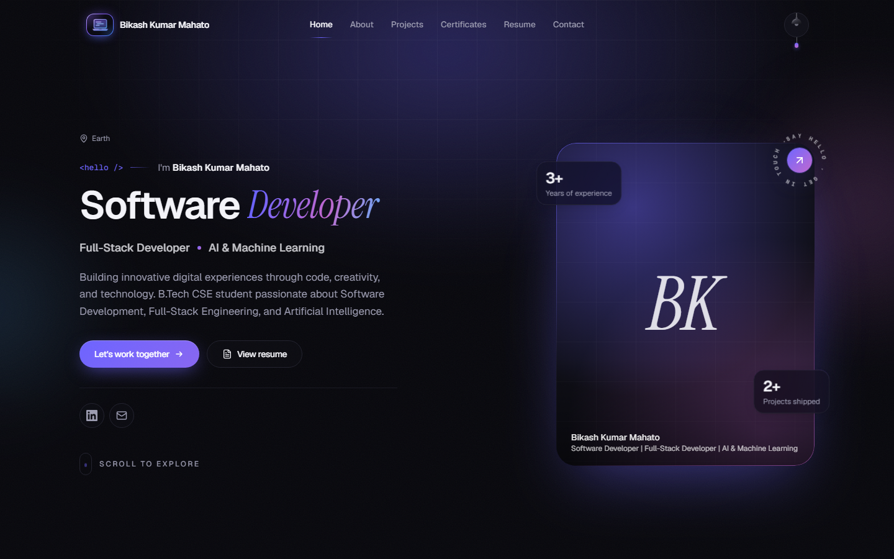
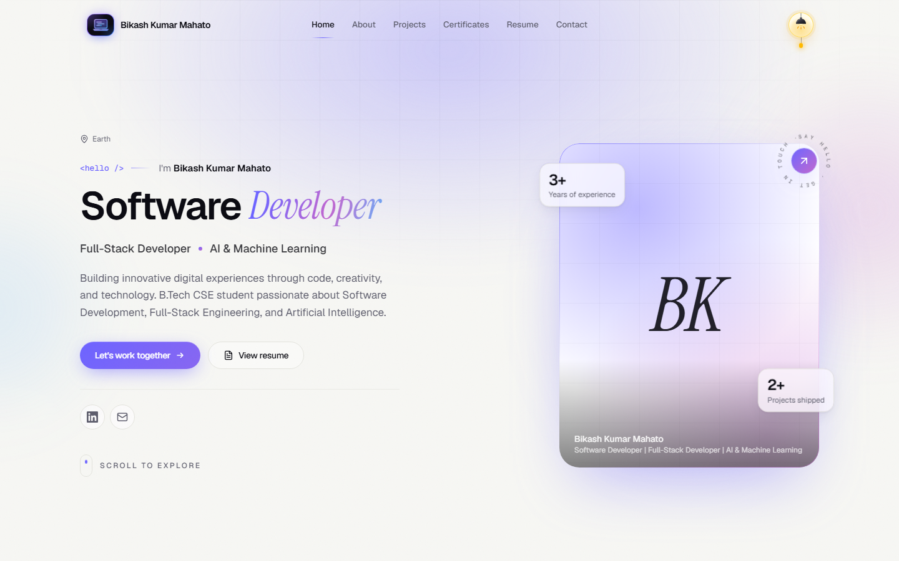
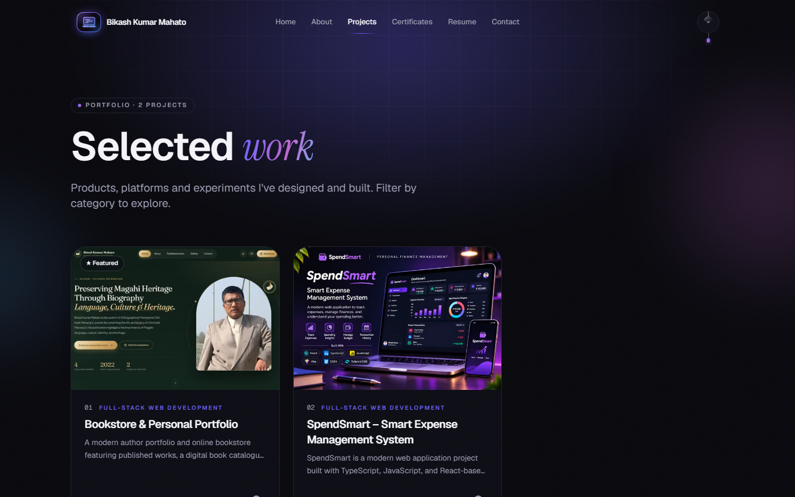
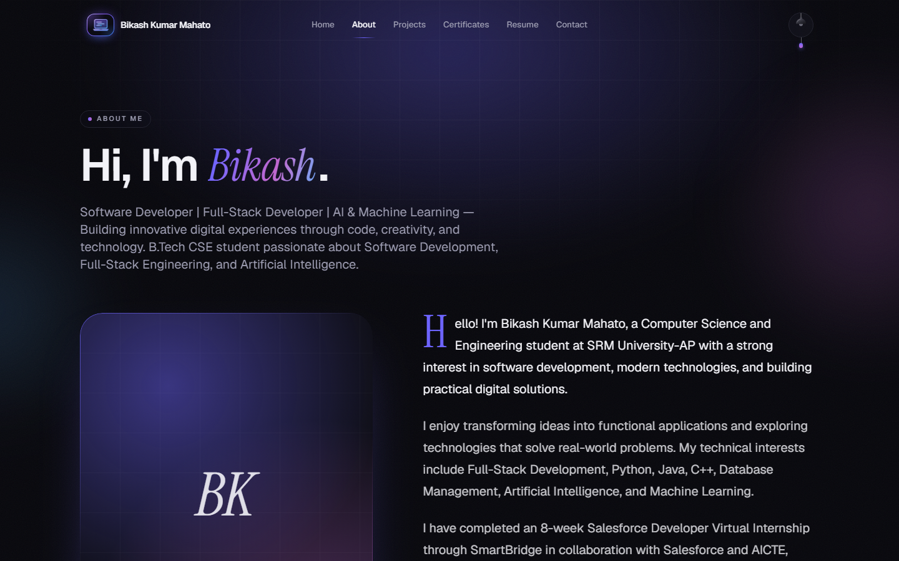
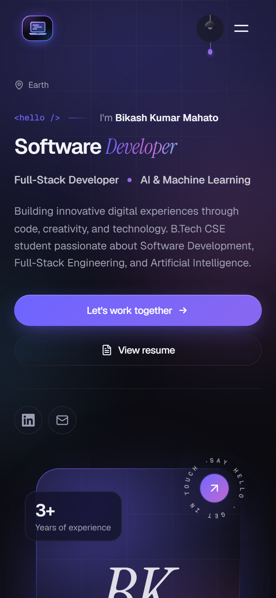
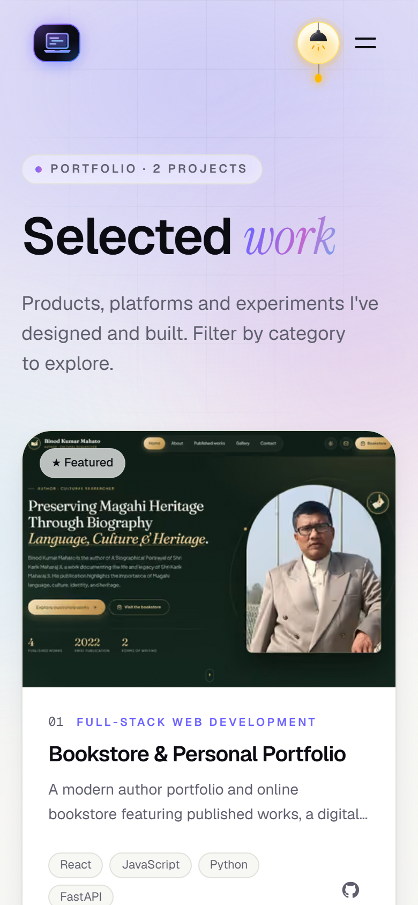
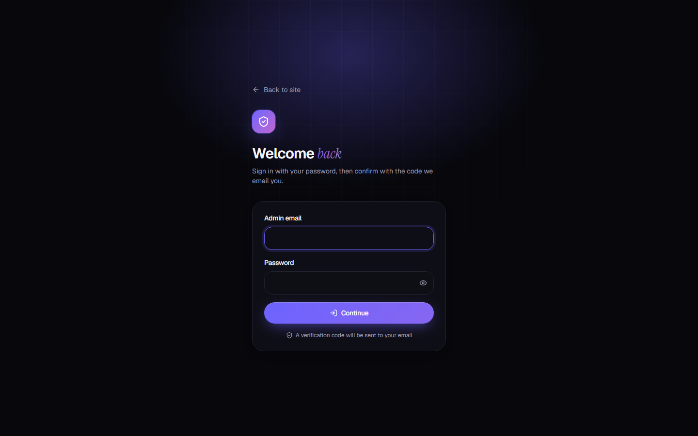

# Portfolio + Admin Panel

A full-stack, mobile-first personal portfolio with a secure admin panel and a REST API for the companion mobile app.

**Stack:** Next.js 15 (App Router) · TypeScript · Tailwind CSS v4 · **MongoDB Atlas** (data, auth and file storage via GridFS) · Framer Motion · Zod · Tiptap · PWA

## Screenshots

### Home — dark & light mode
Pull the lamp in the top-right corner to switch themes.

| Dark | Light |
|---|---|
|  |  |

### Projects & About

| Projects | About |
|---|---|
|  |  |

### Mobile

<p>
  
  &nbsp;&nbsp;
  
</p>

### Admin panel — secure login
Password + email verification code; only the registered admin can sign in.



## Features

**Public site** (Home · About · Projects · Certificates · Resume · Contact): Home is a sequence of portfolio sections (hero, about snapshot with stats, selected projects, experience timeline, featured certificates, resume call-to-action). About covers bio, facts, skill bars and experience/education timelines. Projects has a category filter and detail pages. Certificates is a filterable gallery with a detail viewer and "Verify credential" links. Resume is generated from your data, with a scroll-spy table of contents, Download PDF and a clean **Print / Save as PDF** layout. Contact saves its form to MongoDB. Also: light/dark mode, smooth scrolling, SEO (metadata, Open Graph image, JSON-LD, sitemap, robots), ISR, loading skeletons and empty states.

**Admin panel (`/admin`)**: email/password login for admin accounts stored in MongoDB. It has a dashboard with stats (projects, certificates, messages, unread, site visits) and full CRUD for profile, skills, experience, education, projects (rich-text details) and certificates (with image upload). There's also a messages inbox (read/unread/delete/reply) and site settings (title, SEO, theme colour). Images and files are stored in MongoDB (GridFS). Every form is validated with Zod on both client and server, and actions show toast notifications. The layout has a collapsible sidebar on desktop, a drawer on mobile, and turns tables into cards on small screens.

**PWA**: web manifest, generated app icons (regular and maskable), service worker with offline fallback — installable from the browser menu ("Install app" / "Add to Home Screen").

## Architecture

```
Browser ──(pages, server actions, httpOnly cookie)──┐
                                                    ├─► Next.js server ──► MongoDB Atlas
Mobile app ──(REST /api/*, Bearer token)────────────┘     (src/lib/server)     data · users · sessions · files
```

The database connection string lives only on the server. Neither the browser nor the mobile app ever sees it.

### What's stored in MongoDB

| Collection | Contents |
|---|---|
| `profile`, `settings` | Single documents (`_id: "main"`) |
| `skills`, `experiences`, `education`, `projects`, `certificates` | Portfolio content |
| `messages` | Contact form submissions |
| `users` | The admin's profile record (no password — that lives only in the server env as a bcrypt hash) |
| `otp_challenges` | Pending login codes — stored only as hashes, auto-expire after 10 minutes |
| `sessions` | Login sessions, stored as **SHA-256 hashes** of the token, auto-expire after 30 days (TTL index) |
| `login_attempts` | Failed-login throttle (8 per email+IP per 15 minutes, auto-expire) |
| `page_views` | Visit counter |
| `push_tokens` | Admin devices that receive "new message" notifications |
| `media.files` / `media.chunks` | Uploaded images and the CV (GridFS), served at `/api/media/<id>` |

### Security model
| Data | Public | Admin |
|---|---|---|
| profile, settings, skills, experiences, education | read | full CRUD |
| projects, certificates | read where `published` | full CRUD (sees hidden) |
| messages | create only | read / update / delete |
| media | read | upload |

Every admin server action and API route verifies the session against MongoDB on the server. Web sessions use an httpOnly, SameSite=Lax cookie, and cookie-authenticated API writes also require a same-origin `Origin` header (CSRF protection). The mobile app uses a Bearer token kept in the device keychain. Uploads are limited to images, PDF and Word files (max 4 MB; SVG is rejected) and are served with a sandboxing Content-Security-Policy.

## Project structure

```
scripts/
  setup-db.mjs            Indexes + default profile/settings     (npm run db:setup)
  seed.mjs                Demo content for empty collections     (npm run db:seed)
  set-admin-password.mjs  Server-side admin tools: status, AUTH_SECRET, password reset, re-open registration (npm run admin:password)
src/
  app/
    (site)/               Public pages
    admin/                Login + protected admin pages; actions.ts = server actions
    api/                  REST API (public content, contact, auth, admin CRUD, uploads, media)
  components/             UI kit, site and admin components
  lib/
    server/               ← MongoDB-only code: db.ts, auth.ts, repo.ts (all queries), media.ts (GridFS), push.ts
    admin/resources.ts    One registry describing every admin resource (fields, Zod schema, list columns)
    data.ts               Cached public data for pages (never throws)
    validations.ts        Shared Zod helpers and schemas
  middleware.ts           Sends signed-out visitors from /admin to the login page
```

To add a field to a resource, add it to the field list and schema in `src/lib/admin/resources.ts`. MongoDB is schemaless, so no migration is needed. The admin form, validation, API and list pick it up automatically.

## 1. MongoDB Atlas setup

1. Create a free account at [mongodb.com/cloud/atlas](https://www.mongodb.com/cloud/atlas/register) and create a **free M0 cluster**.
2. **Database Access → Add New Database User**: choose *Password*, set a username and a strong password, and give it the role **Read and write to any database**. Save the password.
3. **Network Access → Add IP Address**:
   - Local development: **Add Current IP Address**.
   - Vercel: choose **Allow access from anywhere** (`0.0.0.0/0`). Vercel's IP addresses change, and access is still protected by the database user's password.
4. **Database → Connect → Drivers**: copy the connection string, which looks like
   `mongodb+srv://<username>:<password>@cluster0.xxxxx.mongodb.net/?retryWrites=true&w=majority`
   Replace `<password>` with your password. If it contains special characters such as `@ : / ? # %`, [URL-encode](https://www.urlencoder.org/) them.

## 2. Run locally

Requires Node.js 20.19+.

```bash
npm install
cp .env.example .env.local        # paste your MONGODB_URI
npm run db:setup                  # indexes + default profile/settings
npm run db:seed                   # optional demo content
npm run admin:password -- --email you@example.com --secret-only   # sets ADMIN_EMAIL + generates AUTH_SECRET
npm run dev
```

Open http://localhost:3000 for the site and http://localhost:3000/admin/register to create the admin account (one time only — see below).

| Variable | Description |
|---|---|
| `MONGODB_URI` | Atlas connection string (server-only, never exposed to browsers) |
| `MONGODB_DB` | Database name (default `portfolio`) |
| `NEXT_PUBLIC_SITE_URL` | Your public URL (used in sitemap, canonical URLs and OG tags) |
| `EXPO_ACCESS_TOKEN` | Optional. Only needed if you enable Expo "enhanced push security" |

Other scripts: `npm run build`, `npm start`, `npm run lint`, `npm run typecheck`. Forgot your password? On the server run `npm run admin:password -- "new-password"` — it replaces the hash and signs out every session.

> The service worker and visit tracking only run in production builds (`npm run build && npm start`).

## Maintenance mode

**Admin → Dashboard** (or **Site settings**) has a *Maintenance mode* switch. When it's on:

- every public page shows a compact "Website temporarily down for maintenance" screen — animated **BKM** logo, your optional message, and a schedule with the **maintenance start** and **estimated completion** date/time (both editable in the admin; the start defaults to the moment you switch it on), a live countdown and a real progress bar — and is marked `noindex`;
- the contact form and the public JSON API (`/api/public/*`) are paused (HTTP 503) — only `/api/public/status` keeps answering;
- the admin panel works as normal, and the admin header shows a *Maintenance mode on* pill.

Turn it off and the site is back instantly; visitors already on the maintenance page are reloaded automatically (it checks `/api/public/status` every 30 seconds). Use **Preview page** to see the screen without turning it on.

## Admin login & security

**One-time registration.** While no admin account exists, `/admin/login` sends you to `/admin/register`. Only `ADMIN_EMAIL` is accepted: a 6-digit code is emailed to prove you own the inbox, then you choose the password (12+ characters, a letter and a number). It's stored only as a **bcrypt hash (cost 12) in MongoDB**. Completing registration atomically writes a lock record, so **only one admin account can ever be created**. From then on `/admin/register` is a 404 and every signup attempt is refused. Only someone with shell access to the server can re-open it (`npm run admin:password -- --reset-registration`).

After that, access to `/admin` requires **all** of the following — there is no other way in:

1. **Authorised email only** — `ADMIN_EMAIL` (server env). Every other email is rejected, and wrong emails/passwords get the same response and timing.
2. **Password** — checked against the bcrypt hash created at registration. Change it any time in **Admin → Account & security** (requires the current password; signs out every other device).
3. **Email OTP** — a 6-digit code emailed to `ADMIN_EMAIL`. Stored only as a hash; 10-minute expiry, single-use, 5 attempts, 60-second resend cooldown, and only valid on the device that entered the password.
4. **Encrypted JWT session** — only after the code is verified, the server issues a **JWE** (`alg: dir`, `enc: A256GCM`, key derived from `AUTH_SECRET`) containing a random session id, the email and `amr: ["pwd","otp"]`. It's encrypted *and* authenticated, so it can't be read, forged or modified. Web: httpOnly + `SameSite=Strict` + `Secure` cookie. Mobile: Bearer token in the device keychain.

**Every request** to `/admin/*` or `/api/admin/*` is checked twice:
- the **middleware** decrypts and validates the token at the edge (expiry, email, `pwd`+`otp`) before any admin page or API code runs — invalid cookies are deleted and admin responses are `no-store` / `noindex`;
- the **server** then looks up the session in MongoDB (stored only as a hash) so it can be revoked, and enforces automatic expiry.

**Automatic expiry:** sessions end after `SESSION_MAX_AGE_HOURS` (default **12 h**) no matter what, and after `SESSION_IDLE_MINUTES` (default **60 min**) of inactivity. The browser warns one minute before an idle sign-out and signs out automatically; the server enforces the same limits.

**Attempt limits (15-minute lockouts):** 8 failed passwords per email+IP, 20 per email, 30 per IP across all emails (stops password spraying); 5 wrong codes destroy the challenge.

**Security alerts:** you're emailed when the account is registered, on every successful sign-in (time, IP, device), when the password changes, and whenever a lockout is triggered.

**Server recovery tools** (need shell access to the server):

```bash
npm run admin:password                                  # status: email, registration, AUTH_SECRET, SMTP
npm run admin:password -- "my-new-strong-password"      # forgot it? reset the password (signs out every session)
npm run admin:password -- --reset-registration          # delete the password and re-open one-time registration
npm run admin:password -- --secret-only --rotate        # rotate AUTH_SECRET (invalidates every session token)
```

**Email delivery of the code (SMTP)** — add to `.env.local` (and Vercel env vars):

```
SMTP_HOST=smtp.gmail.com
SMTP_PORT=465
SMTP_USER=you@gmail.com
SMTP_PASS=your-16-character-app-password
SMTP_FROM=Portfolio Admin <you@gmail.com>
```
For Gmail, turn on 2-Step Verification and create an **App Password** at https://myaccount.google.com/apppasswords (your normal Gmail password won't work). In development, if `SMTP_PASS` is empty the code is printed in the server terminal instead; **in production, admin login is refused until SMTP is configured.**

Check it with `npm run mail:test` — it logs in to Gmail and sends a test email to `ADMIN_EMAIL`, with a clear message if the App Password is wrong or the SMTP port is blocked. (Spaces in the App Password, as Google displays it, are ignored.)

**Deploying to Vercel:** add `ADMIN_EMAIL`, `AUTH_SECRET`, `NEXT_SERVER_ACTIONS_ENCRYPTION_KEY` (copy the exact values from `.env.local`), optionally `SESSION_MAX_AGE_HOURS` / `SESSION_IDLE_MINUTES`, and the `SMTP_*` variables in Project → Settings → Environment Variables.

## 3. Deploy to Vercel

1. Push this folder to a GitHub repository.
2. At [vercel.com/new](https://vercel.com/new), import the repo. The framework is detected as Next.js.
3. Add the environment variables above (`MONGODB_URI`, `MONGODB_DB`, and `NEXT_PUBLIC_SITE_URL` set to your production URL).
4. Make sure Atlas **Network Access** allows `0.0.0.0/0` (step 1.3), then click **Deploy**.

Content changes made in the admin panel or the mobile app appear on the live site immediately (on-demand revalidation). Pages also revalidate every 60 seconds.

## REST API (used by the mobile app)

| Method & path | Auth | Purpose |
|---|---|---|
| `GET /api/public/{profile,settings,skills,experiences,education,projects,certificates}` | – | Published content |
| `GET /api/public/projects/:slug` | – | Single project |
| `POST /api/messages` | – | Contact form |
| `GET /api/media/:id` | – | Uploaded file (`?download=1` to download) |
| `POST /api/auth/login` → `{ token }` · `POST /api/auth/logout` · `GET /api/auth/me` | token | Session |
| `GET/POST /api/admin/:resource` · `GET/PUT/DELETE /api/admin/:resource/:id` | admin | CRUD for skills, experiences, education, projects, certificates |
| `GET/PUT /api/admin/singletons/{profile,settings}` | admin | Profile & settings |
| `GET /api/admin/messages` · `POST {action:"read-all"}` · `GET/PATCH/DELETE /api/admin/messages/:id` | admin | Inbox |
| `GET /api/admin/stats` · `POST /api/admin/upload` (multipart) · `POST/DELETE /api/admin/push-tokens` | admin | Dashboard, uploads, push |

Errors are JSON `{ error, fieldErrors? }` with 401 (not signed in), 403, 404, 422 (validation) or 429 (too many login attempts).

## Mobile app

An Expo (React Native) app in [`mobile/`](mobile/) uses this site's REST API, so it shares the same MongoDB data. It has a public portfolio view plus an admin mode with full CRUD, camera uploads and push notifications for new messages. Setup, EAS builds and store publishing steps are in [mobile/README.md](mobile/README.md).

## Personalising

Everything about you (name, title, bio, photo, CV, socials) lives in **Admin → Profile**. The site title, SEO description, keywords, share image and **accent colour** (default `#6C63FF`) live in **Admin → Settings**. App icons and the Open Graph image are generated from your initials and accent colour automatically.
